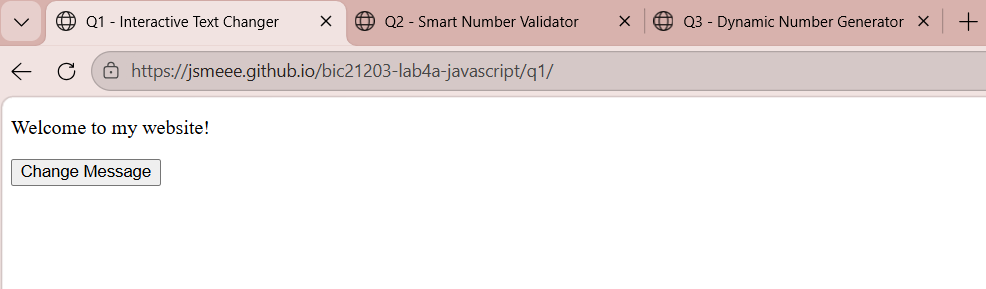
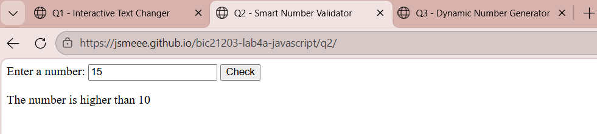
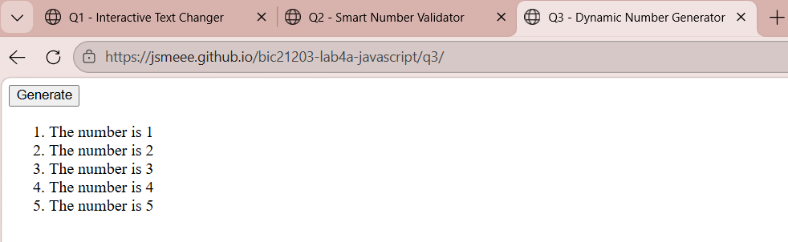

BIC 21203 Lab 4A JavaScript

NAME : ALYEA VANEESA ANAK JERMAN
MATRIC NUMBER : AI250106
SECTION : SECTION 2

QUESTION 1 :
Interactive Text Changer using DOM selection,function and event listener.

QUESTION 2 :
Smart Number Validator using if-else statements and input validation.

QUESTION 3 :
Dynamic Number Generator using for loop and DOM manipulation.

How To RUN :
1. Open Q1 : https://jsmeee.github.io/bic21203-lab4a-javascript/q1/
2. Open Q2 : https://jsmeee.github.io/bic21203-lab4a-javascript/q2/
3. Open Q3 : https://jsmeee.github.io/bic21203-lab4a-javascript/q3/

GitHub Repository Link : 

QUESTION 1 SCREENSHOT :

QUESTION 2 SCREENSHOT :

QUESTION 3 SCREENSHOT :

